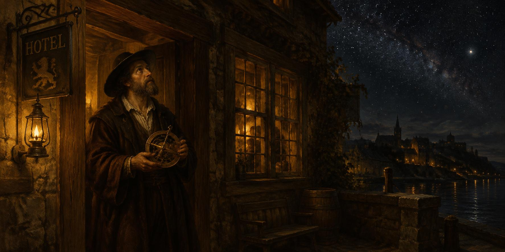

8 de noviembre de 2026

# Astrología, montaña, prensa y hotel

La madrugada encontró a la racha encadenándose sola: cada salto convocado por el salto anterior, sin que nadie tuviera que pedirlo, la primera pieza que el taller produjo y verificó en vivo con su formato nuevo. Y los huecos que quedaban en la semana se rellenaron minuto a minuto desde la fuente pública, como quien repone con paciencia las láminas que le faltaban a un álbum.

La mañana entera fue un seminario de probabilidad pura. La asistente midió caminos en zigzag lanzados desde puntos al azar, bandas de altura conocidas antes de entrar, curvas de promedios contra la montaña del día entero, y cada estudio volvió con sus números contados y sus límites confesados. Sobre esa mesa de mediciones llegó la conversación grande: Newton ordenando los astros, los cuerpos que después se negaron a dejarse predecir, la firma de una carta que no permite reconstruir la carta. Y entonces cayó el veredicto que llevaba días formándose en la casa: juzgar el futuro por el pasado es astrología, cuando los cuerpos del asunto no se cuentan con los dedos de una mano.

Fue un veredicto de constructor, no de escéptico. En lugar de cerrar la puerta, abrió otra: si la gráfica no anuncia el futuro, que el taller escuche la fuente. Así nacieron los publicadores nuevos, uno atento al cotizado y otro a la prensa oficial del banco y del tesoro, instalados y probados en vivo antes del mediodía, y así se encargó también un parte de prensa hermoso para cada mañana, destilado de los boletines de la industria a la hora en que amanece.

La tarde trajo la limpieza grande. Leyó con lupa los textos que gobiernan la casa, encontró preámbulos repetidos que cansaban la lectura y mandó a podarlos de una vez; jubiló dos máquinas viejas que ya no servían a nadie, y las dieciséis piezas del método quedaron escritas como debieron estar desde el principio: diciendo primero qué son. Y en medio de esa poda llegó el momento del día: el sitio recibió por fin su nombre. Ya no es una casa genérica, es Hotel Osmancito, sin posesivo, con el Lobby de puerta principal y la marquesina encendida para quien llegue de noche.

Hubo también cátedra de mercado, de esas que empiezan con una línea misteriosa en la gráfica y terminan en lección completa: qué son las posiciones cortas y por qué quien apuesta a la baja tiene que comprar cuando sube, qué mide el precio de costo y en qué se distingue del promedio de compra, el polvo diminuto que dejan las comisiones repartidas en tres monedas, y la pregunta limpia del final, cómo se reparte el valor de todo un mercado entre sus monedas.

Ya de noche, una noticia sobre el gigante de las pastillas de silicio, esas que piensan por las máquinas, le abrió el apetito de historia, y la asistente le trajo toda una era de la industria destilada en una página: los nombres, las traiciones, las apuestas y la factura que se paga por depender de un solo proveedor. Y el día se cerró a la luz de la Destilería, leyendo el capítulo de la psicología del dinero, pidiendo la cita que un párrafo presentaba y viéndola aparecer en su sitio, recuperada del libro mismo, mientras el capítulo nuevo llegaba a la estantería con sus puentes ajustados al presupuesto de la casa.

El ánimo cierra en curiosidad limpia: la del hombre que se pasa el día preguntando cómo funciona el mundo y se acuesta sabiendo un poco más.

© 2026 Osmancito

---

Parte del día — La tarde, cuando el sitio recibió su nombre: Hotel Osmancito.

Lectura en curso — *Mientras Escribo*, de Stephen King, y *La psicología del dinero*, de Morgan Housel.

En la copa — Una bebida de bautizo.
