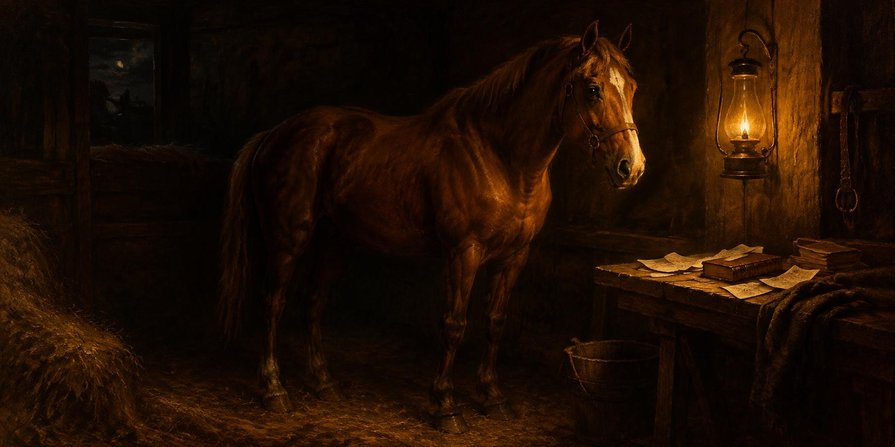

10 de noviembre de 2026

# Sacudida, sobremesa, caballo y fichas

La madrugada fue de acabados. El simulador aprendió a dar su estado completo —sus activos, su posición, sus tenencias y a qué precio las compró— con un solo comando, y el medidor del miedo y la codicia del mercado quedó integrado en su bloque, con su atribución, pidiendo permiso una sola vez por reporte. Y entonces el taller cruzó una frontera: la máquina aprendió a actualizar su propio manual y su propio historial por la misma vía solemne de los parches, con paquete, verificación y aprobación, como todo lo demás. Él lo vio funcionar de maravilla y lo celebró como lo que era: una frontera cruzada.

Media mañana, el dato de inflación del norte salió a su hora exacta y el mercado entero tembló, con réplica propia más tarde. La lección llegó clara: el radar del taller mira los precios pero no mira el calendario, y de esa fragilidad descubierta nació en el día la agenda de los eventos que mueven mercados, verificada fecha por fecha en las fuentes oficiales y guardada en su página.

Y de la sacudida nació la sobremesa grande, de esas que empiezan en un número y terminan en la condición humana. Quién calcula la cifra oficial, qué es eso de la expectativa que defrauda al mercado por décimas, dónde queda la maldad cuando las instituciones se dicen neutras, y si la manzana está sobre la mesa o donde la pone la mano. Él debatió, rió, empujó contra la objetividad de la asistente y la obligó a sostenerse: conversación de las que dejan el cerebro encendido.

La tarde trajo el caballo. En la sala de la Tesorería nació una página viva con su propia ilustración —primero tipográfica, luego encarnada— que pidió retoques de anatomía hasta quedar bien plantada, y que muestra su tarjeta perfecta cuando alguien comparte el enlace. De paso se cazó un salto del desplazamiento que molestaba en cada actualización, medido con paciencia hasta encontrar la causa, y el precio diminuto de las monedas pequeñas aprendió a mostrarse sin perder cifras.

Hubo también cátedra de mercado, de las que él recorre como una armería: las capas de las cadenas, las acciones convertidas en fichas digitales, la lista completa de los pares negociables ordenada de ganadores a perdedores, y la capitalización que crece mucho con entradas pequeñas. Cada respuesta con sus fuentes y sus límites dichos, y él feliz como un niño en una tienda de instrumentos.

La noche fue la gran obra: el rescate del primer publicador, que abarcará el universo completo de pares en fichas por activo, con un constructor que rellena huecos hora por hora, con comando propio y con parte en vivo de su marcha, porque uno tiene que poder administrar su tiempo. La simulación del segundo publicador cumplió su escuela y se retiró con honores, dejando las franjas como oficio limpio. Y a mitad de la gran reconstrucción se fue la luz otra vez, y él se rió de la suerte: menos mal, porque el corte en mitad de la escritura enseñó la lección que faltaba —los archivos se escriben enteros o no se escriben, que un apagón no los parta— y esa reparación ya quedó lista para su aprobación. Los boletines del día cerraron la noche con sus dos partes entregados y revisados.

El ánimo cierra en constructor contento: hubo cátedra, filosofía, un caballo y una obra grande, y hasta los apagones le dejaron lección y risa.

© 2026 Osmancito

---

Parte del día — La mañana, cuando la máquina aprendió a escribir su propio manual.

Lectura en curso — *Mientras Escribo*, de Stephen King.

En la copa — Una bebida de sobremesa.
