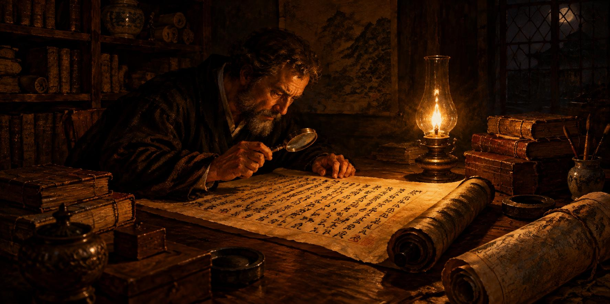

11 de noviembre de 2026

# Alfabetos, rankings, radios y velas

La madrugada firmó la lección del apagón: la escritura atómica quedó aplicada, y los archivos del taller ya se escriben enteros o no se escriben, para que ningún corte de luz los parta a la mitad. Y la ruta corta de pruebas se jubiló: el camino nuevo es la reconstrucción completa del archivo, activo por activo, en el orden de la importancia que cada uno tiene en el mercado.

De ese orden nacieron dos listas que llegaron publicadas a la sala de la Tesorería: primero la de los pares según su vaivén del día, y después la de la capitalización, depurada a mano hasta quedar limpia —sin remiendos de cifras inciertas, con las acciones convertidas en fichas en su propia sección y la moneda corriente fuera de la tabla—. Él pidió la escala unificada, con todos los ceros a la vista, porque así se ve el tamaño comparativo de las cosas, y así quedó.

Y en mitad de la marcha llegó la frontera del día: la máquina aprendió a leer un nombre escrito en caracteres chinos. Hasta entonces su alfabeto era el de casa; ahora un activo con nombre de ideogramas entra y sale del archivo como cualquier otro. Él no lo creyó hasta verlo, y al verlo celebró el hito como lo que era: la barrera de los alfabetos rota.

Los boletines del día llegaron con una sección nueva, la que mira qué podría mover cada noticia entre los activos que se pueden comprar, y la agenda de los eventos creció con fechas verificadas una a una en sus fuentes. Hubo además tarea de escuela para la víspera: una empresa de cómputo que habla mañana, estudiada en sus papeles originales, y una lección buena sobre cómo una acción y su ficha digital respiran distinto cuando la bolsa abre y cuando cierra.

La sobremesa fue musical. Él encontró un catálogo inmenso de radios del mundo y, ante demasiadas puertas, pidió criterio prestado. La asistente escuchó de verdad: cada emisora comprobada sonando en vivo antes de recomendarla, y entregó una selección de electrónicas serenas que ya suenan en la casa.

La noche siguió la marcha del archivo, que pasó de la mitad de la lista. Hubo un susto doméstico: la máquina se apagó un rato por un olvido y, al volver, el guardián retomó el trabajo exactamente donde lo había dejado, como si nada. Y se cazó una omisión escondida: el activo que mide a todos los demás no estaba en la lista, por venir esta de los pares; su reparación ya está preparada, con filas neutras para que la lista no cargue la excepción.

El ánimo cierra alto: hubo hito de alfabetos, listas publicadas, música nueva en la casa y una máquina que ya se recupera sola de los tropiezos domésticos.

© 2026 Osmancito

---

Parte del día — La mañana, cuando la máquina leyó su primer nombre en caracteres chinos.

Lectura en curso — *Mientras Escribo*, de Stephen King.

En la copa — Una bebida de música.
