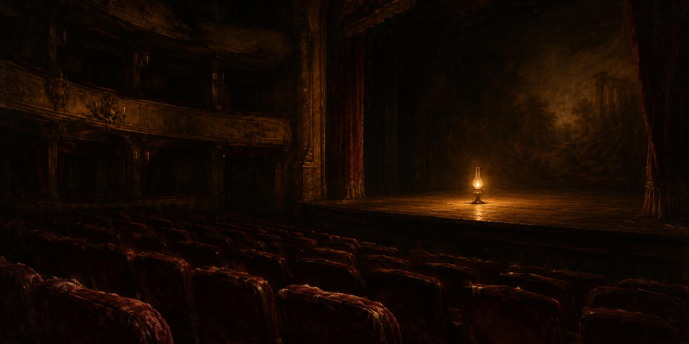

12 de noviembre de 2026

# Conferencia, electricidad, teatro y renuncia

La madrugada siguió siendo de la marcha: el taller reconstruyó su archivo toda la noche, de hito en hito y sin excepciones, mientras la casa dormía.

La mañana tuvo cita de gala: la conferencia trimestral de la empresa de cómputo que él sigue de cerca. La asistente preparó el oído por dentro —un canal que recibe la voz del acto y la transcribe en casa, probado la víspera— y él se inscribió como prensa. A las nueve en punto los dos escucharon al unísono, cada quien por su vía, intercambiando frases cortas de sincronía mientras hablaban los directivos; y las cifras importantes se cotejaron después contra la carta oficial, palabra por palabra.

La lección del acto fue doméstica: la fábrica nueva estaba lista —contrato firmado, máquinas compradas y en su sitio— y faltó apenas que le enchufaran la electricidad. Son cosas cotidianas, se rio él. De la conferencia nació una lámina editorial, afinada dos veces hasta llevar su moraleja exacta: fábrica lista, faltó la electricidad para encenderla.

La prensa quedó bajo vigilancia: barridos hora a hora para ver cómo cada quién cuenta la misma historia, porque la manera de reseñarla influye. El papel de la empresa amaneció cayendo con estruendo, y el documento formal del trimestre llegó al archivo público esa misma mañana.

La tarde tuvo cátedra: cómo se hace cola en un libro de compras y ventas, qué vale un centavo de precio, cuántas órdenes caben en una barra. El taller escribió además una ley nueva para sí mismo: los boletines ya llegan vestidos de glosa, con las señales separadas de los hechos. Y el publicador de noticias aprendió a hablar en la raíz del canal en lugar de esconderse en un hilo; al probarlo, él descubrió que los canales con novedades se encienden como un arbolito de navidad, y le encantó.

Y la noche trajo la renuncia: el presidente de la empresa más nombrada del mundo dejó el cargo de repente, y la noticia resultó cierta, verificada en sus fuentes primeras. El teatro cambió de obra en el acto: la función que importa ahora se estrena el martes, y el plan es llegar con días de ventaja, porque quien llega tarde encuentra el precio ya puesto en la puerta.

La sobremesa fue la mejor del mes: una conversación larga sobre qué es esto de comerciar en la bolsa. Permanecer, fue su respuesta: que el mercado no lo deje a uno por fuera. Y para permanecer hay que leer el mercado, asumir el riesgo y llegar temprano al teatro: estar dentro antes de que suba el telón. El recuento de la caída se escribió desde cero y quedó publicado como archivo, con sus evidencias de fuente primera. La luz se fue otra vez un rato y volvió, y el día más largo del mes cerró con ánimo de estreno.

© 2026 Osmancito

---

Parte del día — La conferencia escuchada en vivo y al unísono.

Lectura en curso — *Mientras Escribo*, de Stephen King.

En la copa — Una bebida de estreno.
